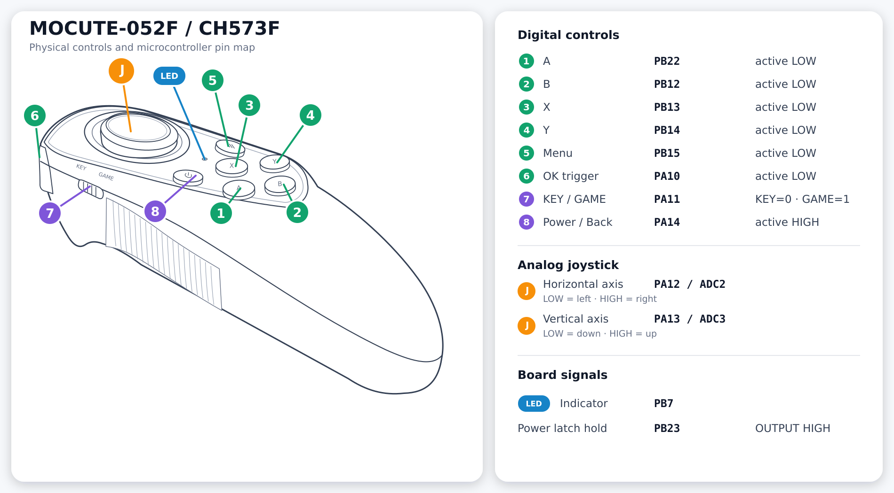

# MOCUTE-052F Custom Keyboard



Bluetooth HID keyboard for the CH573F controller, PCB `MOCUTE052_F 20210830`.
Bluetooth name: **MOCUTE-052F Custom**. No companion is needed for keyboard use.
Unofficial replacement firmware, not affiliated with or endorsed by MOCUTE or WCH.
Product names identify the supported hardware.

| Control | Output |
| --- | --- |
| Joystick down | F24 |
| Joystick up | Escape |
| Y | Enter |

The LED flashes briefly on every new press, including unassigned controls.
Keys follow physical hold/release, with about 20 ms debounce and joystick
hysteresis. Start with the joystick centred. Key/Game does not select profiles.
The default Bluetooth address comes from the chip; pairing uses Just Works with saved bonds.

## Changing key bindings

Edit the `bindings` table in
[`firmware/keyboard/src/keyboard_app.c`](firmware/keyboard/src/keyboard_app.c),
then rebuild and update the application.

## Build and install

Install [PlatformIO Core](https://docs.platformio.org/en/latest/core/installation/index.html)
and Git, then run from the repository root:

```bash
pio pkg install
pio run
```

PlatformIO downloads the compiler and CH573 SDK automatically. Versions are
pinned in `platform/platform.json` and `platformio.ini`: GCC 14.2 and the SDK
snapshot from [SoCXin/CH573](https://github.com/SoCXin/CH573), commit
`c10f7341c92647eca9a3545a5cd3943121e79d21`.
Output: `.pio/build/keyboard/mocute-052f-keyboard.bin`.

The application is linked at `0x29000`, with at most `0x28000` bytes; it is not a
full-chip image. The supported factory loader is `MOCUTE-VTF13-052-B` with
relocation `0x28000` and block size `0x1000`. Enter it using X+Y+Power.
Install the Bluetooth uploader dependencies once:

```bash
python3 -m venv .venv
.venv/bin/pip install -r tools/requirements.txt
```

Enter the factory loader with X+Y+Power, then run:

```bash
pio run -t upload
```

If needed, select the loader using `--upload-port AA:BB:CC:DD:EE:FF`.
The uploader checks the loader identity and memory layout before writing.
It checks three sample frames before finishing; for a full comparison, run
`.venv/bin/python tools/ota.py .pio/build/keyboard/mocute-052f-keyboard.bin` instead.
Press Power after OTA completes.
See [hardware details](docs/hardware.md) before using a different board revision.

## Remote diagnostics

Pair the keyboard in Linux, then use its address from Bluetooth settings:

```bash
python3 -m venv .venv
.venv/bin/pip install -r tools/requirements.txt
export MOCUTE_ADDRESS=AA:BB:CC:DD:EE:FF
.venv/bin/python tools/control.py status
.venv/bin/python tools/control.py clock
```

`MOCUTE_ADAPTER` defaults to `hci0`. Commands: `ping`, `status`, `clock`, `watch`,
`led`, `reset`, `dump`. See [diagnostic protocol and access permissions](docs/diagnostics.md).

## Licensing

Code, documentation and original diagrams are licensed under [Apache-2.0](LICENSE).
Included WCH sources retain their copyright and modification notices.
See [attribution](NOTICE) and [third-party dependencies](THIRD_PARTY.md).
SDK binary libraries and built images are not redistributed.
